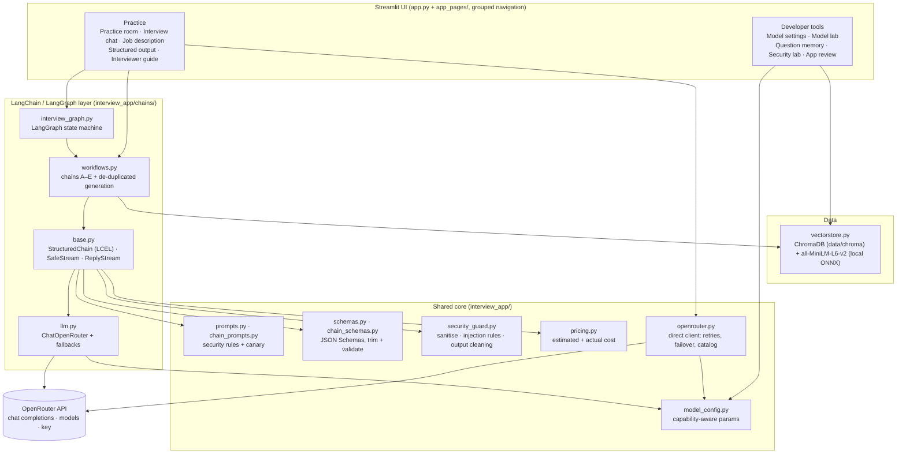
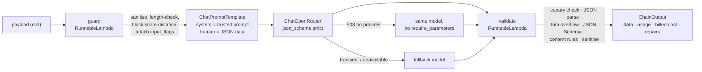
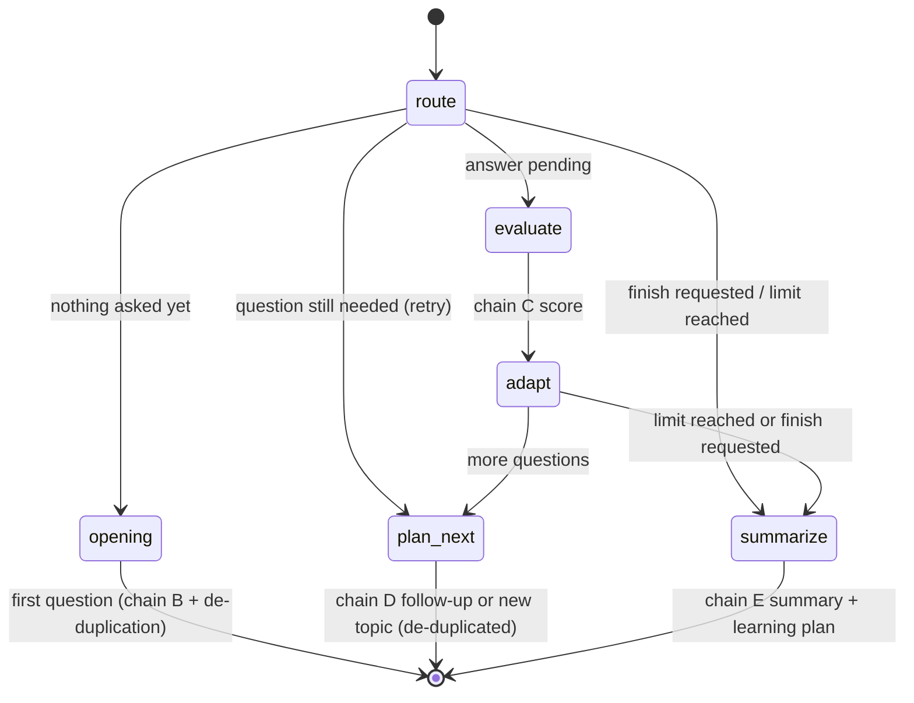

# Architecture

Fieldnotes is a Streamlit application backed by OpenRouter. The original one-shot features (practice room, job description, structured output, interviewer guide) are preserved. The advanced features add a LangChain/LangGraph layer and a ChromaDB vector store on top of the same security, model-configuration, and cost modules.

## Components

- **Original features** call `openrouter.py` directly (retries, `require_parameters` routing, failover, cost).
- **Advanced features** go through LangChain: `ChatOpenRouter` from `langchain-openrouter`, configured from the same `build_request_body`, so both paths send identical, capability-filtered parameters.
- Every model output, on either path, is parsed, schema-validated, and sanitised before display.

## LangChain chain pipeline (every chain A–E)

## Interview workflow (LangGraph)

One graph invocation per user action. State is checkpointed per interview thread with `InMemorySaver` (browser session only, never written to disk), which provides resume. The Streamlit page runs the graph in a worker thread and streams the interviewer's feedback (chain C result → streamed reply) while chain D chooses the next question.

## Data and context flow per chat turn

| Step | Sent to the model | Not sent |
| --- | --- | --- |
| Chain C (evaluate) | current question, the answer, expected answer points, job context | earlier turns |
| Streamed reply | the question and a compact evaluation | the answer itself, history |
| Chain D (next question) | latest turn (answer ≤2,000 chars), previous turn (≤600 chars), one-line memories of older turns, topics covered, asked questions to avoid | full transcript |
| Chain E (summary) | compact per-turn records (scores, strengths, weaknesses, missing concepts) | answers, transcript |

The UI transcript is stored in graph state for display and resume, but no node ever sends it to the model.

## Security boundaries

1. **Input**: `security_guard` (deterministic) at the UI boundary and again as the first step of every chain.
2. **Prompt**: trusted catalog values only in system prompts; untrusted text only as JSON data; canary token.
3. **Output**: canary rejection, JSON Schema validation, benign-overflow trimming, string sanitisation; streamed text is sanitised incrementally (`SafeStream`).
4. **Data at rest**: only generated question text and non-sensitive metadata are stored in ChromaDB; interviews live in memory for the browser session.
5. **Secrets**: the API key stays server-side, is never rendered or logged, and error messages are mapped to fixed text.
